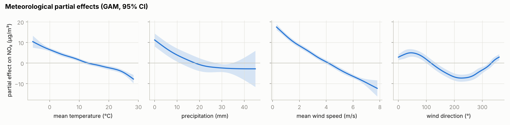
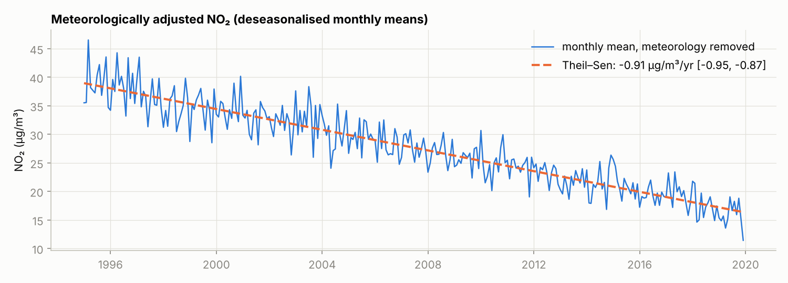
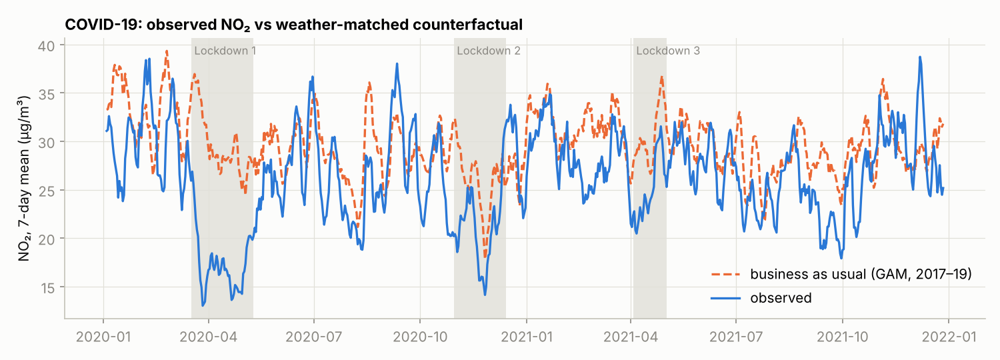

# NO₂ in Paris: meteorological normalisation, long-term trend and COVID-19 lockdowns

Concentrations of NO₂ move with the weather (wind disperses it, low temperatures
favour inversions, rain washes it out) at least as much as with emissions. To
evaluate an emission-reduction policy, or the effect of the 2020 lockdowns, the
meteorological signal has to be removed first. This project models daily NO₂ at
the Airparif station in Paris 13e from Météo-France observations (Parc Montsouris),
1995–2023.

- **Original study:** [`report_air_quality_ile-de-france.pdf`](report_air_quality_ile-de-france.pdf)
  — literature review (GAM, random-forest weather normalisation with `rmweather`,
  LSTM, synthetic control), GAM fits, Theil–Sen trend and a COVID-period comparison.
- **This code:** a rewritten, tested version of the GAM analysis that corrects
  several methodological problems of the original notebooks (see
  [Notes on the original analysis](#notes-on-the-original-analysis)).

## Method

`airquality.py` implements three analyses; `run_pipeline.py` runs them and writes the tables and figures.

**1. How much of NO₂ does meteorology explain?** A GAM with smooth effects of
temperature, precipitation and wind speed, and a **cyclic** spline for wind direction
(0° and 360° are the same direction), is scored by **leave-one-year-out**
cross-validation. Daily NO₂ is autocorrelated over several days, so shuffled
K-fold CV puts near-duplicate days in the training and test sets and overstates skill.

**2. Meteorologically adjusted trend.** Time and meteorology are fitted jointly,

$$\text{NO}_2(t) = \beta_0 + s_{\text{time}}(t) + f_1(\text{TM}) + f_2(\text{RR}) + f_3(\text{FFM}) + f_4^{\circ}(\text{DXY}) + f_5^{\circ}(\text{day of year}) + \gamma_{\text{weekday}} + \varepsilon_t ,$$

and the adjusted series is NO₂ minus the four meteorological partial effects.
Fitting time jointly matters: if meteorology alone is fitted first, a
meteorological trend (warming, for example) can absorb part of the emission trend.
The adjusted series is averaged by month and deseasonalised. Its trend is estimated
with the **Theil–Sen** slope (median of pairwise slopes, robust to outlying months),
with a 95% confidence interval, and tested with the **Mann–Kendall** test. The lag-1
autocorrelation of the detrended monthly series is reported, because positive
autocorrelation would make the Mann–Kendall p-value anti-conservative.

**3. COVID-19 lockdowns.** A GAM trained on 2017–2019 (meteorology, day of year,
weekday) predicts *business-as-usual* NO₂ for 2020–2023 under the weather that
actually occurred. Observed minus predicted, averaged over each national lockdown
(17 Mar–10 May 2020, 30 Oct–14 Dec 2020, 3 Apr–2 May 2021), estimates the lockdown
effect. The model has no time term because splines cannot extrapolate a trend, so
the training window is kept short.

## Validation on synthetic data with a known answer

The Airparif extraction is not redistributable (see [`data/README.md`](data/README.md)).
To show that the pipeline is correct, `make_synthetic_data.py` generates a dataset
with the same schema in which the answer is known. It has realistic meteorology, a
multiplicative effect of weather and weekday on NO₂, AR(1) noise, an emission
baseline falling by 1 µg/m³ per year, and planted lockdown reductions.
`tests/test_pipeline.py` asserts the recovery below.

| Quantity | Truth | Recovered |
|---|---|---|
| Trend 1995–2019, meteorology removed (µg/m³/yr)¹ | −0.92 | −0.91, 95% CI [−0.95, −0.87]; Mann–Kendall p < 10⁻⁸⁰ |
| Lockdown 1 | −40% | −42% |
| Lockdown 2 | −20% | −20% |
| Lockdown 3 | −15% | −19% |

¹ −1 µg/m³/yr on the emission baseline times the mean weather/weekday multiplier (0.92).

The small overestimate of the lockdown effects comes from the business-as-usual
design itself. The model trained on 2017–2019 does not know that emissions keep
falling after 2019, so its counterfactual for 2020–21 is slightly too high. On real
data, this bias should be bounded using the trend from analysis 2.





*All three figures are from the synthetic data; they validate the code and are not
results about Paris.*

## Notes on the original analysis

Rebuilding the analysis surfaced issues in the original notebooks and report that
this version fixes:

1. **Low test R² is mostly the emission trend, not a weak weather model.** The report
   trains a meteorology-only GAM on 1995–2016 and finds a test R² of 0.18 on
   2016–2020, read there as poor generalisation. A model without a time term cannot
   predict a level that emissions have since lowered. On the synthetic data, where
   meteorology is known to matter, the same meteorology-only model scores a
   leave-one-year-out R² of −0.08. Adding the smooth time trend and calendar terms
   raises it to 0.43.
2. **The Theil–Sen slope was hard-coded and misread.** The notebook set
   `slope = -0.0203…` instead of computing it, and indexed it by day. Over the four
   years analysed, −0.02 µg/m³ per day accumulates to about −30 µg/m³, which is not
   "close to zero". Moreover, a declining trend in weather-normalised NO₂ is the
   emission signal the method is designed to measure; it is not a sign that the
   decorrelation failed. Decorrelation is checked against the meteorological
   variables, not against time.
3. **Shuffled K-fold CV** on daily data was replaced by blocked, year-wise CV.
4. **Wind direction** was modelled with an ordinary spline, which treats 359° and 1°
   as far apart; it now uses a cyclic spline.

## Reproduce

```bash
pip install -r requirements.txt
python make_synthetic_data.py                       # or put the real file in data/
python run_pipeline.py --data data/synthetic_no2_paris.csv --out results/synthetic
python -m pytest -q tests
```

## Limitations

- A single urban background station. Traffic-site and regional-background stations
  would separate local from transported NO₂.
- The GAM is additive on the concentration scale, whereas meteorological effects are
  closer to multiplicative. A log link (`LinearGAM` on log NO₂, or a Gamma GAM) is a
  natural next step.
- The random-forest normalisation from the report (`rmweather`, R) is not ported
  here; comparing it with the GAM on the real data is the obvious extension.
