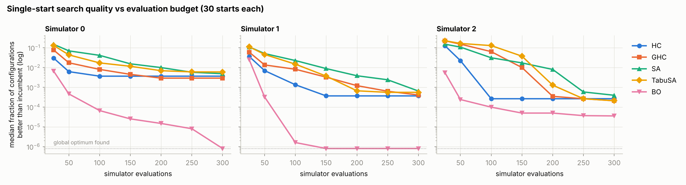
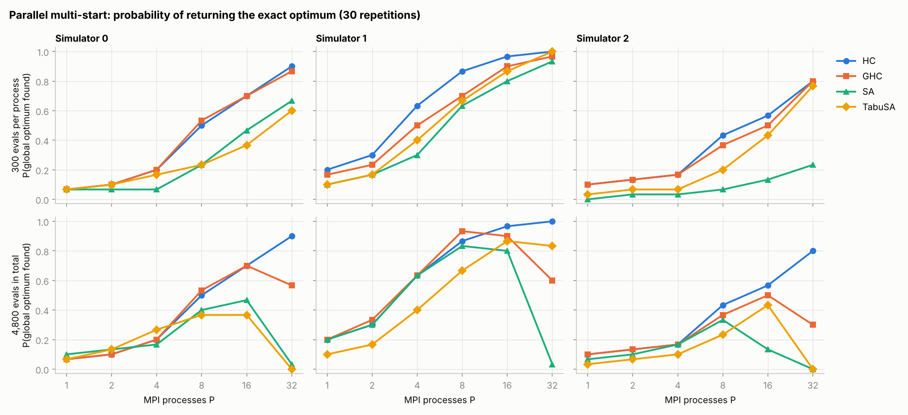
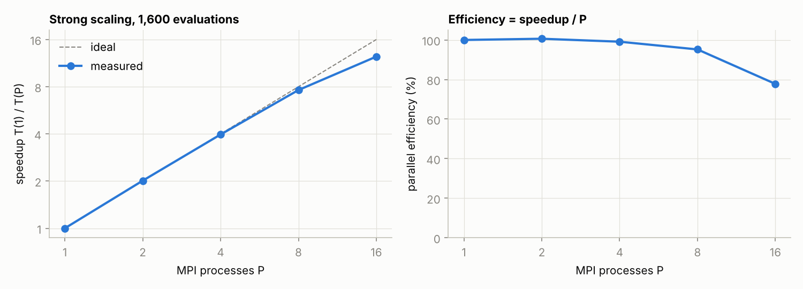

# Tuning a simulated HPC code under an evaluation budget

From the *High-Performance Simulation* course (parallel architectures, MPI and
multicore programming, parallel optimisation, performance metrics).

**Problem.** A simulator (`simulator.py`, provided by the course) predicts the
execution time of an HPC code from five integer parameters:

| | `x` | `y` | `opt` | `nbth` | `disk` |
|---|---|---|---|---|---|
| meaning | problem size 1 | problem size 2 | compiler optimisation level | threads | storage option |
| range | 10–120 | 10–150 | 0–4 | 1–8 | 0–1 |

The lattice has 1,252,440 configurations, and each simulator call stands for a real
run of the code, so calls are the scarce resource. The goal is to find the fastest
configuration with as few calls as possible, and to use MPI to run searches in parallel.
`cost_landscapes.pdf` shows the three cost surfaces over (`x`, `y`).

## What is implemented

| File | Content |
|---|---|
| `heuristics.py` | budgeted evaluator (counts calls, tracks the incumbent, enforces the budget); stochastic hill climbing (**HC**), steepest-descent hill climbing (**GHC**), simulated annealing (**SA**), SA with a tabu list (**TabuSA**) |
| `bayesopt.py` | **Bayesian optimisation** (BO): GP with ARD Matérn-5/2 kernel on log-cost, hyperparameters by maximum marginal likelihood (analytic gradients, L-BFGS-B), expected-improvement acquisition over global and local candidate sets |
| `run_mpi.py` | multi-start search with **mpi4py**: one independent search per rank, then `Gather` of each rank's best point, start point and evaluation count, and `reduce` of the call counts |
| `run_local.py` | the same P searches run sequentially, for checking and for machines without MPI |
| `ground_truth.py` | **exact global optimum** of each simulator by vectorised enumeration of the 1.25M configurations, checked against the scalar simulator |
| `benchmarks/` | method comparison, multi-start experiment, MPI scaling, figures |
| `tests/` | simulator equivalence, neighbourhood and budget invariants, GP gradient check, and **MPI vs sequential drivers return identical results** |

The original course code didn't run: the drivers imported modules that weren't in
the repository (`heuristique`, `tools`, `localSearch`), greedy hill climbing never
advanced its iteration counter, `Reset()` didn't reset, and the "Bayesian
optimisation" fitted a GP but then sampled points uniformly at random.

### Two facts about the problem that shape the results

- **Separable structure.** Every cost function factorises as
  base(*x*, *y*) × f(`opt`) × g(`nbth`) × h(`disk`). So `opt` = 3, `nbth` = 4 and `disk` = 1
  are optimal in all three simulators, and the difficulty lies entirely in the
  (*x*, *y*) landscape. BO models log-cost, where this product becomes a sum, which
  suits a stationary GP.
- **Many local minima.** With unit moves, the (*x*, *y*) surfaces have 36, 8 and 25
  local minima. Hill climbers stop at the first one they reach, after 66–252 calls
  on average, which is why they benefit so much from restarts.

| Simulator | optimal time | optimal configuration | median over all configurations |
|---|---|---|---|
| 0 | 2.378 | (62, 68, 3, 4, 1) | 17.3 |
| 1 | 2.429 | (43, 55, 3, 4, 1) | 15.9 |
| 2 | 0.000110 | (63, 110, 3, 4, 1) | 3.2 |

## Results

### Single search, 300 calls

Each method runs from the same 30 random starting points. SA and TabuSA
temperatures were tuned per simulator on 20 separate starting points
(`results/tuning_sa.csv`). Quality is the fraction of the 1.25M configurations that
beat the returned one, so 0 means the optimum was found; unlike a relative gap,
this stays meaningful for simulator 2, whose optimum is ~10⁻⁴.



| | Sim 0 hit rate | Sim 1 hit rate | Sim 2 hit rate | Sim 2: configurations better than the answer (median) |
|---|---|---|---|---|
| HC | 7% | 20% | 7% | 330 |
| GHC | 7% | 17% | 10% | 261 |
| SA | 3% | 7% | 0% | 493 |
| TabuSA | 0% | 13% | 7% | 261 |
| **BO** | **60%** | **73%** | 0% | **45** |

With the same 300 calls, BO returns the exact optimum in most runs on simulators 0
and 1. It is the only method that keeps improving after the local searches have
stalled, because its acquisition step looks globally instead of moving one unit at
a time. Simulator 2's optimum is a very narrow well (0.0001 against 0.05 for the
best 1% of configurations). No method lands exactly in it, but 6–11× fewer
configurations beat BO's answer than beat the local searches' answers. The price of
BO is its own compute: about 65 ms per iteration on one core, averaged over a
300-call run. That is negligible next to a real simulation, but not next to this
analytic simulator.

### Parallel multi-start with MPI

`run_mpi.py` gives each process its own starting point and keeps the best of the P
answers. The searches don't communicate until the final `Gather`, so the parallelism
is embarrassingly parallel and the question is what it buys in solution quality. Two
regimes, 30 repetitions each (`benchmarks/bench_multistart.py`):

- **weak scaling**: 300 calls per process, so total work grows with P;
- **strong scaling**: 4,800 calls in total, split evenly, so P = 32 means 32 searches of 150 calls.



| Weak scaling, P(exact optimum) | P = 1 | P = 8 | P = 32 |
|---|---|---|---|
| HC, simulator 0 / 1 / 2 | 7% / 20% / 10% | 50% / 87% / 43% | **90% / 100% / 80%** |
| SA, simulator 0 / 1 / 2 | 7% / 10% / 0% | 23% / 63% / 7% | 67% / 93% / 23% |

- **Restarts follow the independent-trials law.** The P runs are independent, so the
  success probability should be 1 − (1 − p)^P. For HC on simulator 0, p = 0.067
  predicts 89% at P = 32; the measured value is 90%.
- **Parallel HC beats sequential BO on wall time and on the hardest simulator.**
  32 hill climbers finish in the time of one (66–120 calls each) and reach 80% on
  simulator 2, where BO with 300 calls never finds the optimum. BO remains far ahead
  per call: 60–73% on simulators 0 and 1 with 300 calls in total.
- **Splitting a fixed budget helps only while each search can finish.** Under strong
  scaling, HC improves all the way to P = 32, because it reaches its local optimum
  in fewer than 150 calls. SA and TabuSA collapse at P = 32: their cooling schedules
  were tuned for 300 calls, and after 150 the temperature is still high, so they
  return points from a near-random walk. GHC drops too, because steepest descent
  needs up to ~250 calls to reach a local optimum. The cooling schedule has to be
  scaled to the per-process budget.

### Wall-clock scaling

`benchmarks/bench_mpi_scaling.py` splits 1,600 calls of SA across P processes. Each
call sleeps 5 ms to stand in for a real simulation; the analytic simulator itself
takes microseconds, so without the sleep the timing would only measure Python and
MPI start-up. The timer runs from a barrier after start-up to the final reduction
(median of 3 runs).



| P | 1 | 2 | 4 | 8 | 16 |
|---|---|---|---|---|---|
| wall time (s) | 8.71 | 4.33 | 2.20 | 1.14 | 0.70 |
| speedup | 1.00 | 2.01 | 3.97 | 7.62 | 12.4 |
| efficiency | 100% | 101% | 99% | 95% | 78% |

Efficiency is ≥ 95% up to 8 processes. At 16 it drops to 78%: the measurements were
made in a 2-core container, so 16 processes contend for the CPU during the
search's own bookkeeping and the final collectives. On a cluster with one core per
rank, and real simulations lasting seconds rather than milliseconds, that overhead
would be negligible.

## Reproduce

```bash
pip install -r requirements.txt               # plus an MPI implementation, e.g. Open MPI
python run_local.py --method BO --sim 0 --max-evals 300
mpirun -n 8 python run_mpi.py --method SA --sim 1 --max-evals 300
python ground_truth.py
python benchmarks/bench_methods.py            # ~20 min on 2 cores (BO dominates)
python benchmarks/bench_multistart.py
python benchmarks/bench_mpi_scaling.py
python benchmarks/make_figures.py
python -m pytest -q tests
```
